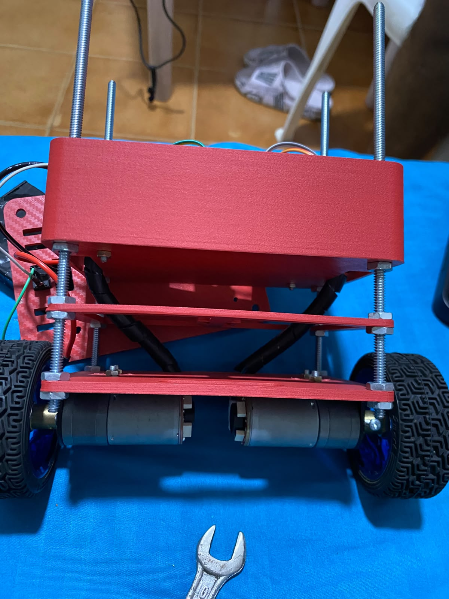
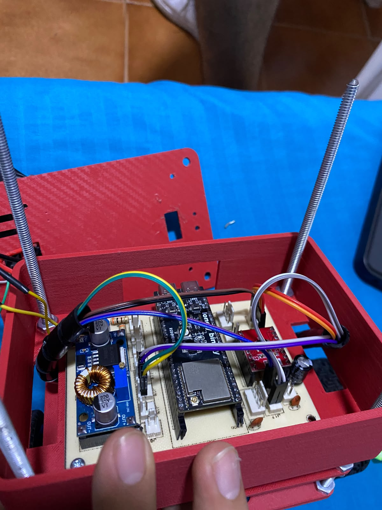

# Ensamblaje Estructural y Montaje del Robot Balancín

El diseño mecánico del robot balancín se planteó con una arquitectura vertical de múltiples niveles, utilizando varillas roscadas para garantizar rigidez, modularidad y facilidad de ajuste en la altura de los componentes. 

A continuación, se detalla el proceso de montaje estructural dividido en cuatro niveles principales, construidos sobre un chasis soportado por varillas de rosca sin fin de 3/16 de pulgada.

## Materiales Estructurales Base
*   Varillas de rosca sin fin (3/16 pulgada).
*   Tuercas y arandelas de 3/16 para fijación y soporte de niveles.
*   Bases/Plataformas (incluyendo una base superior de acrílico).

---

## Estructura por Niveles

### Nivel 1: Chasis Base y Sistema de Tracción
El primer nivel conforma la base principal del robot. En este piso inferior se encuentran anclados los actuadores del sistema.
*   **Montaje:** Se fijaron los dos motores de tracción directamente a la base inferior. Cada motor está asegurado firmemente con dos tornillos para evitar vibraciones u holguras que puedan afectar el control de equilibrio.
*   **Función:** Proporcionar el movimiento de las ruedas y soportar el peso de toda la estructura superior.

### Nivel 2: Sistema Inercial y Centro de Gravedad
Para elevar la estructura, se introdujeron las varillas roscadas de 3/16 en las esquinas de la base. Utilizando dos tuercas del diámetro de las varillas por cada punto de apoyo, se "aprisionó" el piso anterior y se le dio el soporte nivelado a este nuevo piso.
*   **Componente principal:** En este nivel se ubicó estratégicamente el módulo acelerómetro y giroscopio **MPU6050**. 
*   **Función:** Al estar en un nivel intermedio e inferior, permite leer con mayor precisión la inclinación y orientación del carrito balancín, datos vitales para el algoritmo de control.

### Nivel 3: Etapa de Control y Potencia
Continuando con la fijación mediante tuercas a través de las varillas roscadas, se estableció el tercer nivel, considerado el "cerebro" y "corazón" del robot.
*   **Caja de Control:** Aquí se aloja la placa de circuito impreso (PCB) principal que contiene el controlador (ESP) y todo el circuito de potencia y control de los motores.
*   **Alimentación:** Justo encima de la etapa de control, en este mismo nivel, se dispuso el sistema de energía documentado previamente: el portapilas con las 3 baterías de litio 18650 (Configuración 3S) junto con su módulo de protección BMS.

### Nivel 4: Plataforma de Carga (Techo Acrílico)
El último nivel cierra la estructura del chasis en la parte superior.
*   **Montaje:** Se utilizó una base de acrílico transparente para brindar un mejor acabado estético y mayor limpieza visual.
*   **Función Práctica:** Este "techo" no solo protege la electrónica inferior, sino que fue diseñado intencionalmente como una plataforma plana. Sirve de base para colocar objetos sobre el robot, permitiendo realizar pruebas dinámicas ("juegos") donde el robot debe mantener el equilibrio mientras soporta carga extra en su parte más alta, desafiando el algoritmo de control.

---

## Referencias Visuales del Ensamblaje

A continuación se evidencia el resultado final del montaje:

### Prueba de Funcionamiento y Equilibrio

En el siguiente video se observa la prueba dinámica del auto balancín, demostrando la estabilidad y rigides de la estructura 

[Ver video de prueba del robot balancín](imagenes/prueba_balancin.mp4)